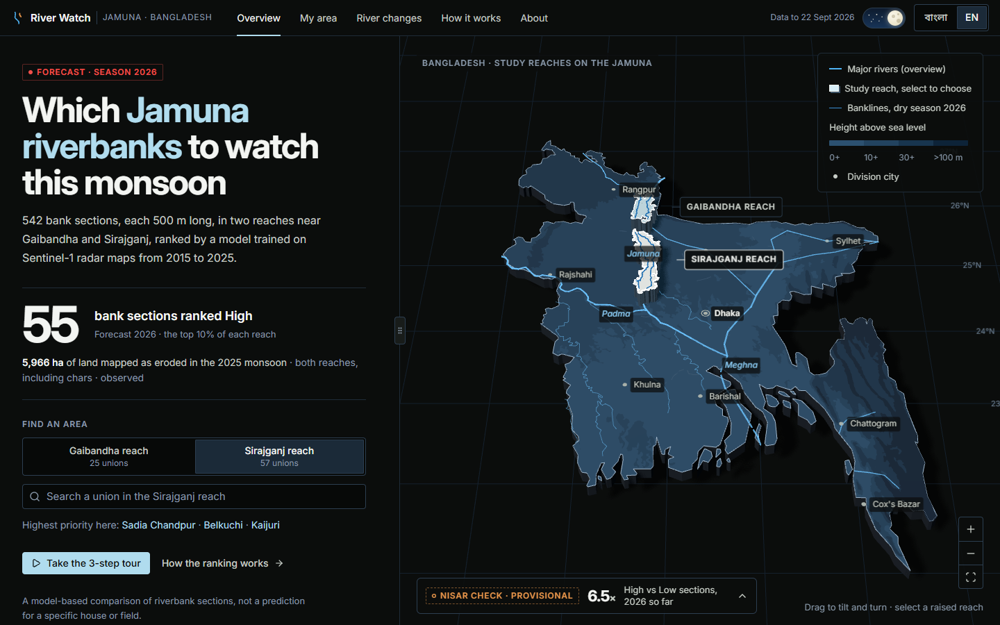
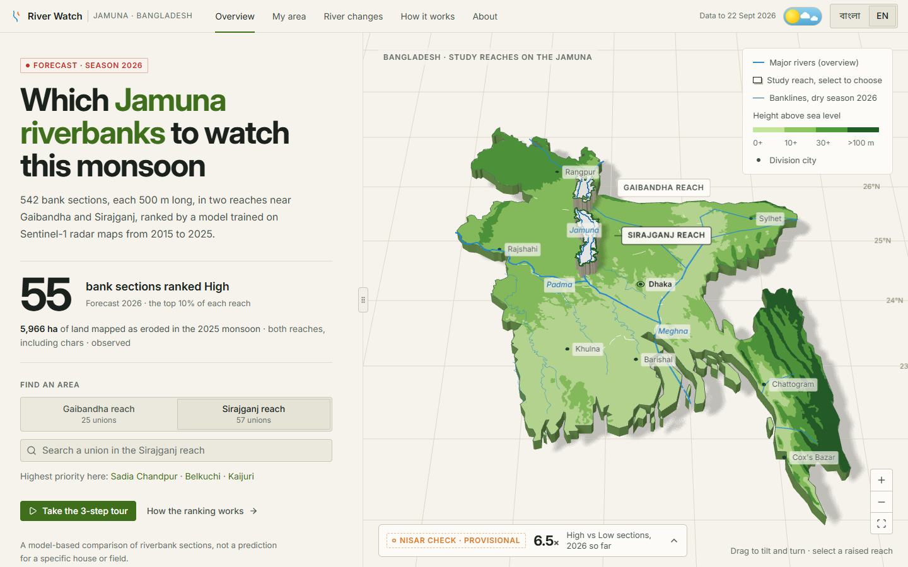
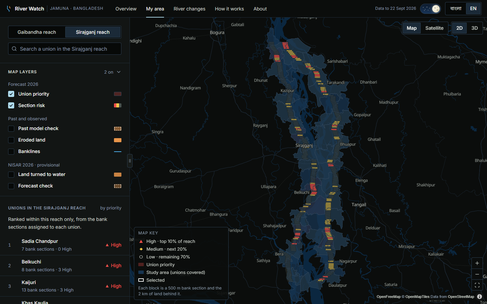
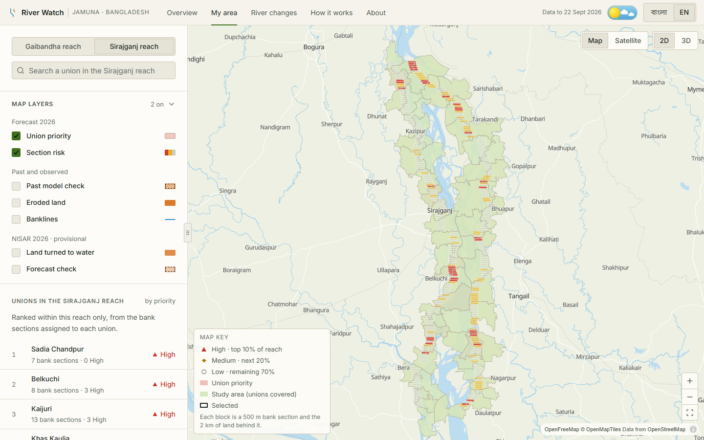
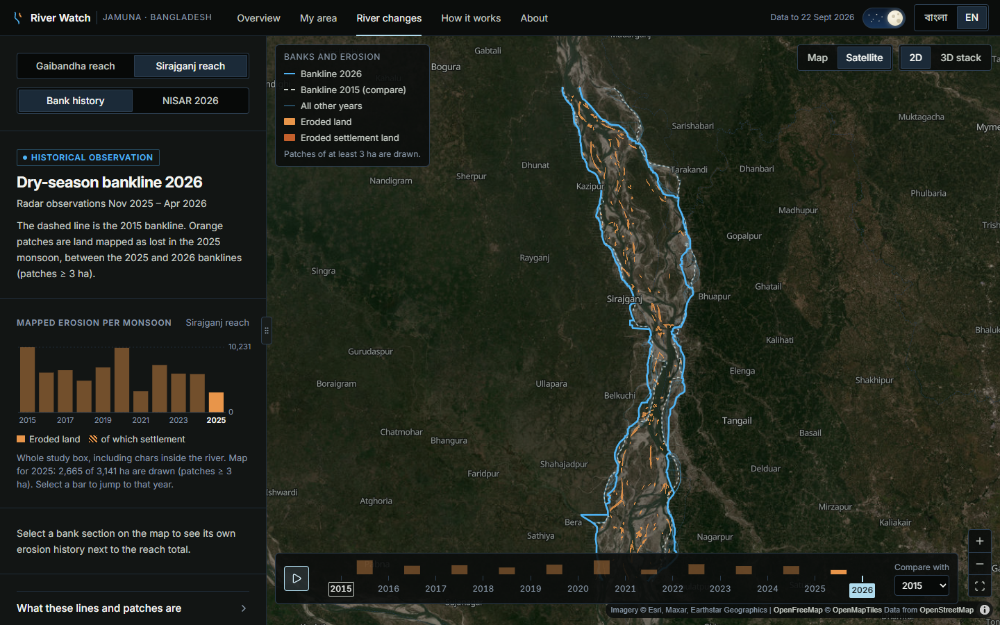
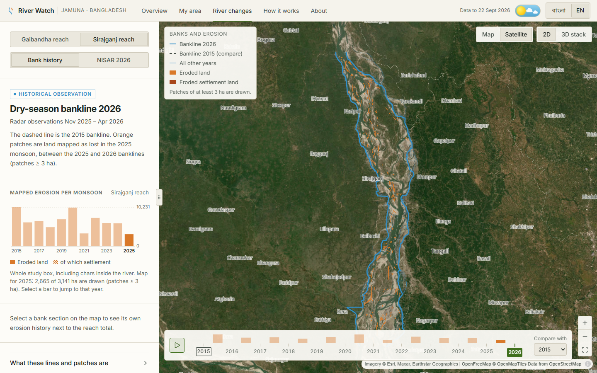
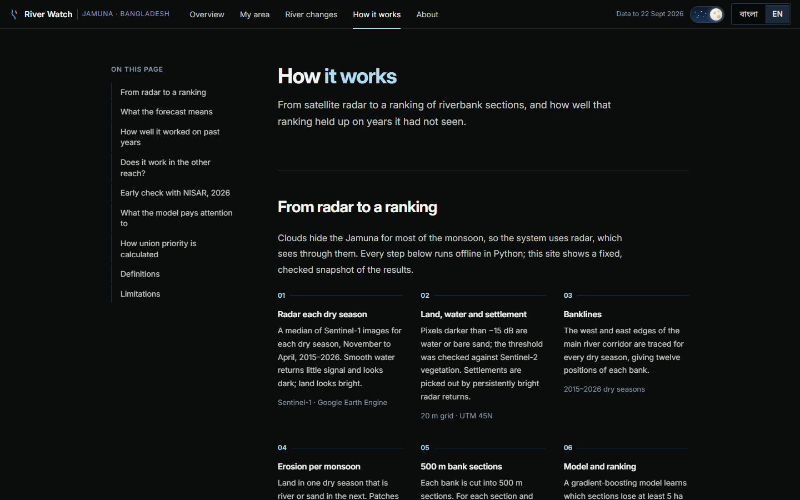
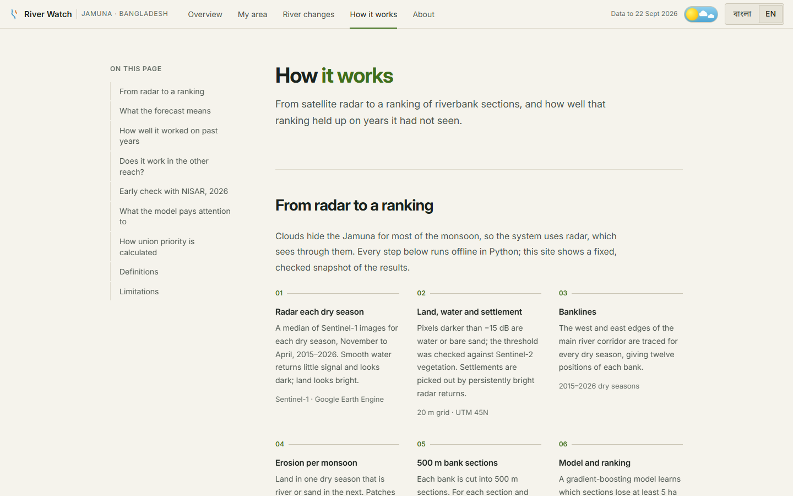
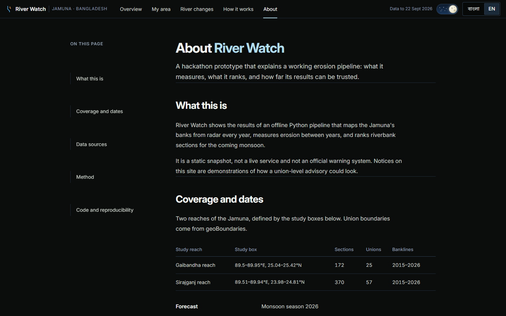
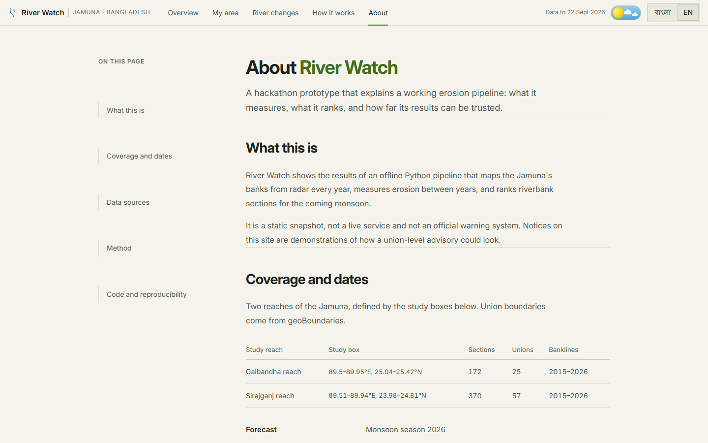

🌐 **[LIVE WEBSITE — RIVER WATCH](https://nasa-river-erosion.vercel.app/)**

# River Watch — Char Erosion Watch

**NASA Space Apps Challenge 2026 · Dancing with the SARs**

River Watch ranks riverbank sections of the Jamuna in Bangladesh by how likely they are to lose land in the coming monsoon, using radar satellites that see through monsoon cloud. It covers two reaches — near **Gaibandha** and near **Sirajganj** — split into **542 bank sections** of 500 m each, across **82 unions**.

- **Pipeline (Python):** maps the river every dry season from Sentinel-1 radar (2015–2026), measures land lost in each monsoon, builds features per bank section, trains a model and ranks sections for the 2026 monsoon.
- **Check (NISAR):** NASA–ISRO NISAR L-band passes from June–September 2026 give an early, provisional test of that forecast on a year and a sensor the model never saw.
- **Website (React):** a bilingual (Bangla / English) site that explains the results, with 3D and 2D maps, light and dark themes.



> A model-based comparison of riverbank sections, **not** a prediction for a specific house or field. High / Medium / Low are relative ranks within each reach, not probabilities, and Low does not mean safe.

---

**Contents:** [Results](#results-at-a-glance) · [Screenshots](#screenshots) · [Repository layout](#repository-layout) · [Quick start](#quick-start) · [The website](#the-website) · [Deploying](#deploying-to-vercel) · [Data sources](#data-sources) · [Limitations](#limitations) · [How we fetched the data](#how-we-fetched-the-data) · [How we built the training data](#how-we-built-the-training-data) · [Model and training](#model-and-training) · [Detailed results](#detailed-results)

---

## Results at a glance

| | |
|---|---|
| Hindcast (trained on monsoons ≤ 2022, tested on 2023–2025) | Flagging the riskiest 20% of sections caught **50%** of major-erosion events; repeating last year's erosion caught 42%, a random pick 19%. PR-AUC 0.282 vs 0.272 for persistence. |
| NISAR 2026 check (provisional, passes to 22 Sep 2026) | Sections ranked **High** saw major erosion **27%** of the time so far, against **4%** for Low (≈ 6.5×). Persistence still has higher recall this year. |
| Forecast | 55 sections ranked High (top 10% per reach) for the 2026 monsoon. |

Full tables and caveats are on the site's **How it works** page.

---

## Screenshots

Every page has a dark (default) and a light theme.

| Dark | Light |
|---|---|
|  |  |
|  |  |
|  |  |
|  |  |
|  |  |

---

## Repository layout

```text
00_region_bbox.py … 10_nisar_check.py   Pipeline steps (see run.txt)
config.py                               Study regions, thresholds, paths
data/                                   Inputs needed to retrain (most outputs are git-ignored)
docs/screenshots/                       Website screenshots used in this README
scripts/prepare_frontend_data.py        Builds the website's data bundle from pipeline outputs
frontend/                               The React website (Vite, JSX only)
web/dashboard.html                      Original single-file Leaflet dashboard (kept as a fallback)
run.txt                                 Plain step-by-step run guide (Windows cmd)
```

---

## Quick start

### 1. Rebuild the results (≈ 3 minutes, no Earth Engine needed)

Python 3.13–3.14. The pinned versions in `requirements-lock.txt` reproduce the documented numbers exactly.

```bat
py -3.14 -m venv nenv
nenv\Scripts\activate           :: macOS/Linux: source nenv/bin/activate
pip install -r requirements-lock.txt
python 05_model.py
python 06_threat_score.py
python 10_nisar_check.py
```

Re-running the satellite steps (01–04, 08–09) needs Google Earth Engine and a NASA Earthdata account — see `run.txt`.

### 2. Prepare the website data

```bash
python scripts/prepare_frontend_data.py
```

Writes a validated bundle to `frontend/public/data/` (≈ 17 MB). It also downloads, once, the public context layers it needs into `data/context/`: geoBoundaries outlines, Natural Earth rivers and AWS Terrain Tiles elevation. Everything is written to a temporary folder, checked, then swapped in — a failed run leaves the previous bundle untouched.

River summaries and photos for the overview map come from Wikipedia / Wikimedia Commons and are stored in `frontend/public/content/rivers.json`. Refresh them with:

```bash
node frontend/scripts/fetch-river-info.mjs
```

### 3. Run the website

Node 22.

```bash
cd frontend
npm install
npm run dev
```

Open [http://localhost:5173](http://localhost:5173). Add `?lang=en` or `?lang=bn` to a link to choose the language.

```bash
npm run build      # validates the data bundle, then builds to frontend/dist
npm run preview    # serves the production build locally
```

---

## The website

| Page | Route | What it answers |
|---|---|---|
| Overview | `/` | Where the study reaches are (3D map of Bangladesh), the headline forecast, a 3-step guided tour |
| My area | `/my-area` | A union's priority, its bank sections, people nearby, the advisory notice; map layers for past checks, erosion, banklines and NISAR |
| River changes | `/river-changes` | Banklines year by year (2015–2026) with play/compare, erosion per monsoon, a 3D time stack; NISAR 2026 tab |
| How it works | `/how-it-works` | Method, evaluation against baselines, feature importance, definitions, limitations |
| About | `/about` | Coverage, dates, data sources and credits |
| River | `/river/:id` | One of the ten major rivers on the overview, zoomed on the map with its summary |

**Stack:** React 19 (JSX), Vite, React Router, TanStack Query, react-i18next, MapLibre GL (keyless OpenFreeMap vector tiles and Esri imagery), three.js for the 3D overview, Inter and Noto Sans Bengali.

**Colour rules** — every hue has one meaning, in both themes:

| Role | Light theme | Dark theme |
|---|---|---|
| Interactive / selected | forest green | powder blue |
| Water, rivers, banklines | sky blue | azure |
| Relative risk High / Medium / Low | red / yellow / grey | red / yellow / grey |
| Observed land loss | amber | amber |
| Overview height tint (low → high) | pale → deep green | steel → Prussian blue |

### Deploying to Vercel

Create a project from this repository with **Root Directory `frontend`** and the **Vite** preset (build `npm run build`, output `dist`). `frontend/vercel.json` rewrites the page routes to the app. The data bundle is committed, so the deployed site needs no server, Python or API keys.

---

## Data sources

Copernicus Sentinel-1 and Sentinel-2 (ESA, via Google Earth Engine) · NISAR L2 GCOV, provisional (NASA/ISRO, via ASF DAAC) · JRC Global Surface Water · Dynamic World · MERIT Hydro · Google Open Buildings v3 · WorldPop 2020 · geoBoundaries · Natural Earth · AWS Terrain Tiles · OpenFreeMap / OpenMapTiles / OpenStreetMap · Esri World Imagery · Wikipedia and Wikimedia Commons (river summaries and photos, CC BY-SA).

Method follows Freihardt & Frey (2023), *Natural Hazards and Earth System Sciences* 23, 751–770.

## Limitations

- Eleven monsoons of history; a rare extreme year may behave unlike any of them.
- Ranks are relative within each reach. Population (WorldPop 2020) and buildings are exposure context, not counts of losses.
- Settlements are inferred from radar brightness.
- NISAR results stay provisional until the falling-river passes of October–November 2026 are processed.
- Only two reaches of the Jamuna are covered, not whole districts.
- Bangla wording on the website still needs review by a fluent speaker.

---

## How we fetched the data

All remote-sensing, terrain, and exposure datasets were ingested programmatically into a unified UTM Zone 45N (`EPSG:32645`) grid at $20\text{ m}$ spatial resolution.

### 1. Sentinel-1 C-band SAR History (via Google Earth Engine)

| Setting | Value |
|---|---|
| **Collection** | `COPERNICUS/S1_GRD`, Interferometric Wide (IW) swath mode, $10\text{ m}$ native resolution, `VV` polarisation |
| **Season window** | One dry season per year: 1 Nov to 30 Apr, spanning 2015–2026 (12 dry seasons) |
| **Orbits** | Ascending relative orbit 114 (land/water mapping), plus descending relative orbit 150 (settlement detection) |
| **Pre-processing** | Incidence angle restricted to $30^\circ\text{--}45^\circ$; seasonal temporal mean across all passes; $7 \times 7$ boxcar spatial filter to suppress radar speckle |
| **Target grid** | UTM Zone 45N (`EPSG:32645`), $20\text{ m}$ pixels |
| **Download method** | Fetched in parallel tiles directly into local storage via `ee.data.computePixels` (bypassing manual Google Drive exports) |

**Annual dry-season classification (1 map per year):**
- **Water / land separation:** Pixels with smoothed ascending backscatter below $-15\text{ dB}$ are classified as water/sandbar, and pixels at or above $-15\text{ dB}$ as vegetated land. Rather than relying solely on the literature cut-off ($-13.2\text{ dB}$), we calibrated thresholds from $-18\text{ dB}$ to $-11\text{ dB}$ against cloud-free Sentinel-2 NDVI vegetation references across 2019–2026; $-15\text{ dB}$ achieved the highest balanced accuracy in both reaches ($0.931$ in Gaibandha, $0.947$ in Sirajganj).
- **Settlement extraction:** Detected via *persistent scatterers*—pixels that remain consistently bright and temporally stable throughout the dry season (amplitude dispersion $< 0.4$ and seasonal mean backscatter $> -4\text{ dB}$) in either ascending or descending passes.

### 2. Auxiliary Physical & Exposure Layers (via Google Earth Engine & geoBoundaries)

| Layer | Purpose |
|---|---|
| **JRC Global Surface Water v1.4** (Landsat, 1984–2021) | Long-term water occurrence percentage; identifies young, easily eroded former riverbed behind banks and long-term channel persistence |
| **MERIT Hydro HAND** (SRTM-derived) | Height Above Nearest Drainage ($m$); distinguishes low-lying, easily saturated floodplain from higher river terraces |
| **Dynamic World V1** | Dry-season open-water probability; separates open channel water directly attacking a bank from protective sandbars (which Sentinel-1 groups together) |
| **WorldPop 2020** ($100\text{ m}$) | Gridded population counts used to estimate residents living within $2\text{ km}$ of each bank section |
| **Google Open Buildings v3** | Building footprints/centroids (confidence $\ge 0.75$) used to measure structural exposure near each bank section |
| **geoBoundaries ADM4** | Administrative union boundaries used to aggregate section-level risk into union-level threat scores |

### 3. NASA–ISRO NISAR L-Band SAR (via NASA Earthdata / ASF DAAC)

| Step | Implementation |
|---|---|
| **Search** | Queried `asf_search` for provisional `NISAR L2 GCOV` products intersecting both study reaches from June 2026 onward |
| **Scene selection** | Ascending Track 69, Frame 14 covers $100\%$ of both reaches. Eight 12-day repeat passes were acquired: 18 Jun, 30 Jun, 12 Jul, 24 Jul, 17 Aug, 29 Aug, 10 Sep, and 22 Sep 2026 (no acquisition between 27 Jul and 10 Aug) |
| **Challenge** | Full HDF5 granules are $2\text{--}9\text{ GB}$ each over $\approx 5\text{ MB/s}$ download links |
| **Chunked streaming** | Opened remote HDF5 files directly over HTTPS using an Earthdata bearer token, parsed the internal HDF5 chunk index, and fetched only the $512 \times 512$ chunks intersecting the river corridors via 32 parallel HTTP byte-range requests, performing `gzip` + byte-shuffle decompression locally ($\approx 3\text{ minutes}$ per pass for both regions) |
| **Reprojection** | Reprojected from $10\text{ m}$ UTM 46N onto the $20\text{ m}$ UTM 45N Sentinel-1 grid by averaging in linear power before converting `HH` and `HV` backscatter to $\text{dB}$ |
| **Crash safety** | Written atomically to `.part` temporary files and renamed only upon completion so interrupted runs resume cleanly |

---

## How we built the training data

1. **Monsoon erosion rasters:** Pixels classified as vegetated land or settlement in dry season $y$ that transition to water/sand in dry season $y+1$ define erosion for monsoon $y$. Connected patches smaller than $1\text{ ha}$ ($25$ pixels at $20\text{ m}$) or disconnected from the main river corridor are removed to eliminate radar noise. This yields **11 monsoon transitions (2015–2025)**.
2. **Main bankline extraction:** For each dry season, the primary river corridor is isolated (largest connected water body after morphological closing, hole filling, and morphological opening to prune narrow side channels). The western and eastern outer edges of this corridor define the annual banklines.
3. **500 m bank sections:** Both banks are partitioned into $500\text{ m}$ sections—**542 sections in total** ($172$ in Gaibandha across $86 \times 2$ banks; $370$ in Sirajganj across $185 \times 2$ banks).
4. **Target variable:** Binary indicator of whether a section lost $\ge 5\text{ ha}$ of land during the monsoon, measured within a zone extending $2\text{ km}$ landward and $60\text{ m}$ riverward of the bankline. Roughly 1 in 5 section-years experience major erosion ($20.9\%$ in Gaibandha, $18.2\%$ in Sirajganj).
5. **Model-ready dataset:** **5,962 labelled rows** ($\text{section} \times \text{monsoon}$, 2015–2025) for training and evaluation, plus **542 unlabelled rows** representing pre-monsoon 2026 conditions for forecasting.

### The 17 physical & historical input features

Exposure variables (population, building counts, and landward settlement area) are intentionally excluded from the model inputs so the classifier learns strictly physical erosion drivers; exposure is incorporated afterward in the union threat score.

| Feature group | Input signals |
|---|---|
| **Past erosion** | Eroded area ($\text{ha}$) in the last 1, 2, and 3 monsoons; 3-year rolling mean erosion; count of eroding years in the last 3 monsoons; eroded settlement area ($\text{ha}$) last monsoon |
| **Bank movement** | Bankline retreat ($\text{m}$) over the last 1 and 2 monsoons; retreat acceleration (change in annual retreat speed) |
| **Bank & channel geometry** | Outward bank bulge ($\text{m}$) into the river; local river corridor width ($\text{m}$); bank side indicator (`west` vs `east`) |
| **Long-term water history (JRC)** | 38-year water occurrence in the channel immediately riverward of the bank; 38-year water occurrence in the land immediately behind the bank |
| **Floodplain terrain (MERIT)** | Height Above Nearest Drainage (`HAND`, $\text{m}$) of the land behind the bank |
| **Pre-monsoon channel state (Dynamic World)** | Dry-season open-water probability touching the bank; year-over-year change in open-water probability at the bank |

---

## Model and training

- **Algorithm:** `HistGradientBoostingClassifier` (`scikit-learn` gradient-boosted decision trees), chosen for strong performance on tabular data, native handling of missing values (such as early-year lag features and 2015 Dynamic World gaps), and resistance to overfitting on an 11-monsoon time series.
- **Hyperparameters:** `max_depth=4`, `max_iter=200` trees, `learning_rate=0.05`, `min_samples_leaf=20`, `l2_regularization=1.0`, `class_weight="balanced"`, `random_state=42`.
- **Baselines compared:** Random selection, persistence (prior monsoon's eroded hectares), 3-year mean erosion, and L2-regularised logistic regression (`SimpleImputer` + `StandardScaler` + balanced `LogisticRegression`).
- **Temporal hold-out (hindcast test):** Trained strictly on monsoons 2015–2022 and evaluated on unseen monsoons 2023–2025 ($1,626$ test rows, $204$ major-erosion events). Random splitting was avoided to prevent spatial and temporal leakage.
- **Cross-region transfer test:** Trained on one reach ($\le 2022$) and tested on the other ($2023\text{--}2025$) to test geographic generalisation.
- **Evaluation metrics:** Precision–Recall AUC (`PR-AUC`), plus `Recall @ Top 20%` and `Precision @ Top 20%` when flagging the riskiest $20\%$ of sections per reach and year. Plain classification accuracy is omitted because predicting "no major erosion" everywhere trivially achieves $\approx 80\%$.
- **2026 Forecast & Union Threat Score:** The final model is retrained on all labelled years (2015–2025) to score the 542 sections for the 2026 monsoon (`High` = top $10\%$ per reach, `Medium` = next $20\%$, `Low` = remaining $70\%$). Each section's predicted risk is combined with recent retreat speed and $2\text{ km}$ community exposure using within-reach percentile ranks ($P$):

$$\text{Section Score} = 0.5 \times P_{\text{model}} + 0.2 \times P_{\text{retreat}} + 0.2 \times P_{\text{population}} + 0.1 \times P_{\text{buildings}}$$

$$\text{Union Score} = 0.6 \times \max(\text{Section Score}) + 0.4 \times \text{mean}(\text{Section Score})$$

Unions with $\text{Union Score} \ge 0.70$ are classified as **High** priority, $\ge 0.50$ as **Medium**, and $< 0.50$ as **Low**.

- **NISAR L-band water threshold calibration:** Because L-band ($\approx 24\text{ cm}$ wavelength) interacts differently with water and vegetation than C-band Sentinel-1 ($\approx 5.6\text{ cm}$), we swept thresholds from $-30\text{ dB}$ to $-5\text{ dB}$ on `HH` and `HV` against reference pixels derived from 38 years of JRC water history ("always water": $\ge 75\%$ JRC occurrence and water in Sentinel-1; "never water": $0\%$ JRC occurrence on elevated ground). Optimal `HH` cut-offs were $-12.25\text{ dB}$ for Gaibandha and $-12.00\text{ dB}$ for Sirajganj.

---

## Detailed results

### 1. Hindcast Evaluation (2023–2025 Unseen Monsoons)

Trained on monsoons 2015–2022 across both reaches and tested on 2023–2025 ($1,626$ section-years; $204$ with $\ge 5\text{ ha}$ erosion):

| Ranking method | PR-AUC | Recall @ Top 20% | Precision @ Top 20% |
|---|---|---|---|
| Random pick | $0.134$ | $19.1\%$ | $12.0\%$ |
| 3-year mean erosion | $0.253$ | $32.4\%$ | $20.4\%$ |
| Persistence (last year's erosion) | $0.272$ | $42.2\%$ | $26.5\%$ |
| Logistic regression | $0.241$ | $43.1\%$ | $27.2\%$ |
| **Gradient boosting (ours)** | **$0.282$** | **$50.0\%$** | **$31.5\%$** |

Monitoring the riskiest 1 in 5 bank sections captures half of all major erosion events—$2.6\times$ better than random selection.

### 2. Cross-Region Generalisation

| Transfer direction | Gradient boosting (PR-AUC / Recall) | Persistence (PR-AUC / Recall) |
|---|---|---|
| **Sirajganj $\rightarrow$ Gaibandha** | **$0.267$ / $38.9\%$** | $0.204$ / $29.2\%$ |
| **Gaibandha $\rightarrow$ Sirajganj** | $0.237$ / $34.1\%$ | **$0.317$ / $49.2\%$** |

A model trained on the larger Sirajganj reach transfers effectively to Gaibandha, outperforming persistence. Training solely on the smaller Gaibandha reach ($86$ segments per bank) does not generalise as well to Sirajganj, confirming the value of pooling both reaches in the final model.

### 3. Top Learned Drivers (Permutation Importance)

Measured as the drop in `PR-AUC` on the 2023–2025 test set when each feature is randomly shuffled:

| Rank | Feature | PR-AUC drop | Physical interpretation |
|---|---|---|---|
| 1 | `jrc_occ_land` | $0.039$ | The land behind the bank is young, unconsolidated former riverbed |
| 2 | `dw_water_river` | $0.029$ | Open channel water (rather than a protective sandbar) sits directly against the bank |
| 3 | `eroded_ha_lag1` | $0.028$ | The bank already experienced active erosion during the previous monsoon |
| 4 | `jrc_occ_river` | $0.013$ | The main river channel has hugged this bank alignment for decades |
| 5 | `bulge_m` | $0.010$ | The bank protrudes outward into the flow on an exposed river bend |

### 4. Sensor Classification Accuracy

- **Sentinel-1 land/water:** $93\%\text{--}95\%$ balanced accuracy against Sentinel-2 NDVI references ($0.931$ in Gaibandha, $0.947$ in Sirajganj at $-15.0\text{ dB}$).
- **NISAR L-band land/water:** $93\%\text{--}99\%$ balanced accuracy across all 8 passes (`HH` $< -12.25\text{ dB}$ in Gaibandha; `HH` $< -12.00\text{ dB}$ in Sirajganj).

### 5. Provisional 2026 Monsoon Validation (NISAR Passes through 22 Sep 2026)

Evaluating the pre-monsoon 2026 forecast against cumulative land loss observed across the first 8 NISAR passes:

| 2026 Forecast tier | Sections losing $\ge 5\text{ ha}$ (overall) | Sirajganj breakdown |
|---|---|---|
| **High** (top $10\%$) | **$27\%$** ($15$ of $55$) | **$38\%$** |
| **Medium** (next $20\%$) | **$13\%$** ($14$ of $108$) | — |
| **Low** (bottom $70\%$) | **$4\%$** ($16$ of $379$) | **$5\%$** |

- Sections ranked **High** experienced major erosion **$6.5\times$ more frequently** than sections ranked **Low** ($7.6\times$ in Sirajganj).
- Flagging the top $20\%$ riskiest sections captured **$53\%$** ($24$ of $45$) of all major-erosion sites observed so far, achieving a `PR-AUC` of **$0.292$** against **$0.083$** for random selection.

### 6. Scale of Erosion & Exposure Across the Study Reaches

- **Total land lost to river (2015–2025):** $\approx 11,000\text{ ha/year}$ across both reaches (including mid-channel char islands as well as outer banks).
- **Settlement land lost (2015–2025):** $\approx 1,190\text{ ha}$ total across both reaches.
- **Exposed population:** $\approx 670,000$ residents living within $2\text{ km}$ of the monitored banks ($154,765$ in Gaibandha; $515,014$ in Sirajganj).
- **Union priority breakdown (82 unions):** **13 High**, **49 Medium**, and **20 Low**.

### 7. Additional Methodological Caveats

- **Modest gain over persistence:** Past erosion is a strong predictor on its own; in the provisional 2026 NISAR check, persistence achieved higher recall ($62\%$ vs $53\%$). The gradient-boosted model's value lies in improving overall ranking precision (`PR-AUC`) and identifying *why* a section is vulnerable (e.g., young riverbed soil or fresh channel impingement) even before major bank retreat begins.
- **Provisional high-water stage in NISAR:** Passes through 22 September capture peak/late-monsoon water levels, meaning temporary overbank inundation cannot yet be fully separated from permanent bank collapse. Re-running `08`–`10` once October–November 2026 falling-river passes are published will produce the final post-monsoon validation without code changes.
- **Radar settlement proxies:** Persistent scatterers detect metal-roofed and dense structures reliably, but can miss thatch/mud dwellings and occasionally flag non-building corner reflectors.